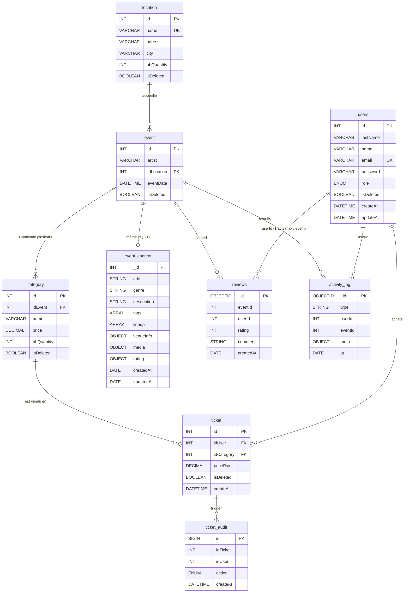

# Schéma des deux bases (MySQL + MongoDB)

Les deux bases sont liées par des **références logiques** (pas de clé étrangère possible entre deux SGBD) :

- `event_content._id` = `event.id`
- `reviews.eventId` = `event.id`
- `reviews.userId` = `users.id`
- `activity_log.eventId` / `activity_log.userId` = `event.id` / `users.id`

## Schéma global



## Légende

| Base | Table/Collections | Rôle |
|---|---|---|
| MySql | `users`, `location`, `event`, `category`, `ticket`, `ticket_audit` | Données transactionnelles (achats, stock, prix) |
| MongoDB |`event_content`, `reviews`, `activity_log` | Contenu éditorial, avis, journal d'activité |

---

# Documentation détaillée côté base de données

Cette partie explique **pourquoi chaque table et chaque collection est dans MySQL ou dans MongoDB**, et décrit **tout ce qui s'exécute côté base** (vues, fonctions, procédures, triggers, droits). Le vocabulaire est celui des cours *SQL avancé* et *NoSQL*. Elle ne couvre volontairement pas l'API Node.js.

## 1. Choix SQL ou NoSQL pour chaque table et collection

Pour chaque table et collection on se demande quelles **requêtes** on lui pose, quelle **forme** a la donnée, quelle **cohérence** est exigée. 
Dans notre cas on a une **persistance polyglotte**, il y a **une seule source de vérité** : ici MySQL, qui porte tout ce qui touche à l'argent. MongoDB ne contient aucune donnée dont dépend une vente.

| Table / collection | Base | Forme de la donnée | Cohérence exigée | Pourquoi ce choix |
|---|---|---|---|---|
| `users` | MySQL (relationnel) | expression régulière, schéma fixe | forte (ACID) | Référencée par `ticket` : la clé étrangère et l'email `UNIQUE` sont garantis par le schéma. Les données personnelles restent à un seul endroit (pas copiées dans MongoDB). |
| `location` | MySQL | expression régulière, donnée de référence | forte | Une salle accueille plusieurs événements : relation 1-N, stockée **une seule fois** et recombinée par **jointure** (3FN). |
| `event` | MySQL | expression régulière | forte | Pivot des ventes. Ses lectures **croisent beaucoup d'entités** (salle, catégories, billets) : c'est le cas où le cours déconseille le document. |
| `category` | MySQL | expression régulière | forte | Porte le prix et le stock : montants exacts (`DECIMAL`) et contraintes `CHECK`. |
| `ticket` | MySQL | expression régulière, très écrites | **forte : stock et quota** | Le cours cite le stock comme exemple de « cohérence forte, quitte à refuser sous panne ». Achat atomique, isolation par verrou de ligne, prix figé (**ACID**). |
| `ticket_audit` | MySQL | journal d'événements liés à `ticket` | forte (atomicité) | Écrit par trigger dans la **même transaction** que l'achat : « billet et trace, ou rien ». |
| `event_content` | MongoDB (document) | **agrégat autonome**, structure variable | cohérence à terme tolérée | Fiche éditoriale (line-up, tags, accès, affiche) **lue en bloc par une clé** (`_id` = `event.id`) : le critère décisif du cours. Les sous-objets sont **embarqués** (bornés, jamais lus seuls). Schéma dynamique encadré par `$jsonSchema`. |
| `reviews` | MongoDB | document, croissance **sans borne** | cohérence à terme tolérée | Le « tableau sans limite » est le piège du cours : les avis sont donc **référencés** (`eventId`) et non embarqués dans `event_content`. La note moyenne est un **précalcul**. |
| `activity_log` | MongoDB | événements applicatifs, schéma mouvant, écriture massive | aucune (donnée jetable) | Insertions rapides sans contrainte, et un index **TTL** (30 jours) supprime les entrées sans tâche de purge. |

**Pourquoi pas les autres familles ?** (« assumer de ne pas changer », cours NoSQL)
- **Clé-valeur (Redis)** : utile pour un cache ou des sessions. Aucun besoin mesuré à ce volume (≈ 300 événements, ≈ 24 000 billets) et les lectures principales passent par des vues indexées : on n'ajoute pas un magasin « au cas où ».
- **Graphe (Neo4j)** : nos questions portent sur des **valeurs** (prix, stock, notes), pas sur des **chemins** de profondeur variable. Les relations sont de profondeur fixe : SQL suffit.
- **Colonnes larges** : pas d'écriture massive distribuée ni de partitionnement nécessaire.
- **Tout dans MongoDB** : l'achat exige des contraintes fortes et des transactions multi-entités, que le cours range dans « Non, si… » pour une base document.
- **Tout dans MySQL** : à ce volume, une colonne JSON pourrait suffire (même constat que le cours avec `jsonb`). La séparation est assumée parce que MongoDB apporte nativement l'index texte en français, l'agrégation, le **TTL** et le schéma dynamique, et isole le contenu éditorial de la chaîne de vente.

**Liaison entre les deux bases** : pas de clé étrangère possible entre deux SGBD. Le lien est une **référence logique** (`event_content._id` = `event.id`, `reviews.eventId`, `activity_log.eventId`). Comme le dit le cours, il n'y a pas de contrainte d'intégrité référentielle côté MongoDB : c'est l'application qui la tient (voir §4).

---

## 2. Vues MySQL

Une vue est une **requête nommée** : elle ne stocke rien, chaque lecture relance sa définition, donc elle est **toujours à jour**. Les quatre bénéfices d'une VIEW sont : 
- **simplifier** (jointures et agrégats deviennent une « table » lisible) 
- **réutiliser** (une seule définition de « places vendues » ou de « chiffre d'affaires » pour l'API et le reporting)
- **sécuriser** (`report_user` n'a accès qu'à deux vues, §5)
- **découpler** (le schéma peut évoluer derrière une vue stable). 

La règle `isDeleted = FALSE` n'est écrite qu'à un seul endroit.

**Pourquoi pas des vues matérialisées ?** Elles sont figées jusqu'au `REFRESH` (fraîcheur contre vitesse). Le stock restant doit être exact à chaque lecture, sinon on afficherait des places qui n'existent plus : on garde des vues simples, rapides grâce aux index `idx_ticket_category` et `idx_category_event`. MySQL n'a de toute façon pas de vue matérialisée native.

| Vue | Rôle | Détails de conception |
|---|---|---|
| **`v_ticket_details`** | Détail complet d'un billet actif : acheteur, événement, salle, catégorie, prix payé. Alimente « Mes billets ». | 4 `JOIN` (`ticket → users`, `category → event → location`). Filtre `t.isDeleted = FALSE` : les billets annulés n'apparaissent pas. `CONCAT(name, ' ', lastName)` produit `userFullName`. Les `JOIN` internes sont adaptés car chaque FK est `NOT NULL`. |
| **`v_category_sold`** | Stock par catégorie : total, vendu, disponible. | **`LEFT JOIN`** sur une sous-requête qui compte les billets non annulés par catégorie : une catégorie **sans aucune vente** apparaît quand même (avec `COALESCE(…, 0)`), alors qu'un `INNER JOIN` la ferait disparaître (le piège « INNER JOIN ou LEFT JOIN ? » du cours). `availableCount = nbQuantity − soldCount`. Le comptage se fait en sous-requête **avant** la jointure pour éviter de multiplier les lignes. Filtre `c.isDeleted = FALSE`. |
| **`v_show_event`** | Catalogue : un événement par ligne avec salle, `ticketsSold`, `revenue`, `minPrice` (prix « à partir de »). Alimente l'accueil et l'API. | `JOIN location`, puis `LEFT JOIN category` et `LEFT JOIN ticket` (un événement sans catégorie ou sans vente reste listé). Les conditions `c.isDeleted = FALSE` et `t.isDeleted = FALSE` sont dans le `ON` et **non** dans le `WHERE`, sinon elles transformeraient le `LEFT JOIN` en `INNER JOIN` (règle du cours : filtre sur la table optionnelle → `ON`, filtre sur la table principale → `WHERE`). `GROUP BY` sur toutes les colonnes non agrégées (conforme à `ONLY_FULL_GROUP_BY`). `COALESCE(SUM(pricePaid), 0)` évite un `NULL` pour le CA. |

---

## 3. Fonctions, procédures stockées et triggers MySQL

Pourquoi de la logique **dans la base** ? Les arguments du cours : la règle est **appliquée pour tous les clients** (API, script, console SQL), elle s'exécute dans **une seule transaction** (atomicité) et elle permet une **sécurité par `EXECUTE`** sans accès direct aux tables. Les limites (logique « cachée », débogage plus difficile) sont compensées par ce document et par les fichiers versionnés `04_functions.sql` et `05_triggers.sql`.

Principe « **contraintes d'abord** » : tout ce qu'un `CHECK`, une clé étrangère ou un `UNIQUE` sait exprimer l'est déjà dans le schéma. Seules les règles qui lisent d'autres lignes (stock disponible, audit, cascade d'annulation) passent en fonction, procédure ou trigger.

### 3.1 Fonctions

| Fonction | Signature | Rôle |
|---|---|---|
| **`fn_available_seats`** | `(p_category INT) → INT` | Places restantes = `category.nbQuantity − COUNT(billets non annulés)`. Renvoie `COALESCE(total, 0) − vendus` : une catégorie inexistante donne ≤ 0, donc « pas de place » (comportement sûr par défaut). `READS SQL DATA` : déclare qu'elle ne modifie rien (nécessaire pour qu'elle soit utilisable dans des triggers avec le binlog activé). S'appuie sur `idx_ticket_category`. |
| **`fn_event_revenue`** | `(p_event INT) → DECIMAL(12,2)` | Chiffre d'affaires d'un événement : somme des `pricePaid` des billets non annulés de toutes ses catégories. `DECIMAL(12,2)` (plus large que le prix unitaire) pour éviter tout dépassement lors de la somme. `COALESCE(…, 0)` renvoie 0 plutôt que `NULL` pour un événement sans vente. |

Ces deux fonctions factorisent un calcul réutilisé par la procédure d'achat **et** le trigger : une seule définition de « place disponible ». Une **fonction** calcule et renvoie une valeur, utilisable dans une requête ou un trigger ; `READS SQL DATA` joue le rôle du `STABLE` du cours (elle lit la base sans l'écrire).

### 3.2 Procédures stockées

Une **procédure** exécute une action (`CALL`) et peut gérer sa propre transaction, ce qu'une fonction ne fait pas : c'est l'outil du « processus métier » comme l'achat. Elles s'exécutent en **`SQL SECURITY DEFINER`** (défaut MySQL), avec les droits de leur propriétaire. Schéma du cours : l'utilisateur applicatif n'a **aucun droit d'écriture** sur `ticket`, la procédure est le seul chemin d'écriture et elle contrôle tout (stock, statut de l'événement, montant). Le piège du `search_path` vu en cours est propre à PostgreSQL : ici les objets sont résolus dans la base `billeterie`.

#### `sp_buy_ticket(IN p_user INT, IN p_category INT, OUT p_ticket_id INT)`

Achat d'un billet. Étapes :

1. **`EXIT HANDLER FOR SQLEXCEPTION`** : en cas d'erreur, `ROLLBACK` puis `RESIGNAL` (l'erreur est propagée au client, mais aucune écriture partielle ne subsiste).
2. **`START TRANSACTION`**.
3. **`SELECT … FOR UPDATE`** sur la catégorie (jointe à l'événement), en vérifiant dans la même requête que : la catégorie n'est pas supprimée, l'événement n'est pas supprimé, **`eventDate > NOW()`** (pas d'achat pour un événement passé). Le prix est lu dans cette même requête.
   - **Verrou de ligne** : deux acheteurs simultanés sur la même catégorie sont **sérialisés** ; le second attend la fin de la transaction du premier avant de compter le stock. Cela supprime la course « les deux voient 1 place restante, les deux achètent » (**survente**).
   - Si aucune ligne n'est trouvée, `v_found` reste à 0.
4. Si `v_found = 0` → `SIGNAL SQLSTATE '45000'` « Catégorie introuvable ou événement terminé ».
5. Si `fn_available_seats(p_category) <= 0` → `SIGNAL` « Plus de places disponibles pour cette catégorie ». Le calcul est fait **sous verrou**, donc fiable.
6. `INSERT INTO ticket` avec `pricePaid = v_price` (**prix figé** à cet instant) ; `p_ticket_id := LAST_INSERT_ID()` renvoyé en paramètre `OUT`.
7. `COMMIT`.

Les erreurs métier utilisent `SQLSTATE '45000'` (« exception définie par l'utilisateur ») avec un message lisible.

#### `sp_cancel_ticket(IN p_ticket INT, IN p_user INT)`

Annule un billet (suppression logique) :

- `UPDATE ticket SET isDeleted = TRUE WHERE id = p_ticket AND idUser = p_user AND isDeleted = FALSE`.
- Le test `idUser = p_user` garantit qu'**on ne peut annuler que ses propres billets** (contrôle d'appartenance dans la base, pas seulement dans l'API).
- `ROW_COUNT() = 0` → `SIGNAL` « Billet introuvable ou déjà annulé » : couvre à la fois un id inexistant, un billet d'un autre utilisateur et une double annulation, sans révéler lequel des cas (pas de fuite d'information).
- Aucune transaction explicite : un seul `UPDATE` est atomique par nature. La trace d'audit est créée par `trg_ticket_after_update`.
- Ne vérifie pas la date de l'événement : l'annulation reste possible après coup (règle métier à durcir si besoin).

### 3.3 Triggers

| Trigger | Moment / table | Rôle |
|---|---|---|
| **`trg_ticket_before_insert`** | `BEFORE INSERT ON ticket` | **Garde-fou de stock** (usage du cours : une règle qu'un `CHECK` ne sait pas exprimer parce qu'elle lit une autre table) : si `fn_available_seats(NEW.idCategory) <= 0`, lève « Stock épuisé pour cette catégorie » et annule l'insertion. Il protège contre toute insertion qui **contournerait** `sp_buy_ticket` (script, console SQL, autre application) : la règle « jamais plus de billets que de places » tient même sans passer par la procédure. Le verrou `FOR UPDATE` de la procédure est ce qui garantit l'absence de course ; le trigger est la deuxième ligne de défense (défense en profondeur). |
| **`trg_ticket_after_insert`** | `AFTER INSERT ON ticket` | Écrit `(NEW.id, NEW.idUser, 'PURCHASE')` dans `ticket_audit` (cas d'école du cours : `AFTER` pour l'audit, avec `NEW`). `AFTER` : l'`id` du billet n'existe qu'une fois l'insertion réussie (et rien n'est journalisé si l'insertion échoue). |
| **`trg_ticket_after_update`** | `AFTER UPDATE ON ticket` | Si `OLD.isDeleted = FALSE AND NEW.isDeleted = TRUE` (comparaison `OLD` / `NEW`), écrit `'CANCEL'` dans `ticket_audit`. La condition sur la **transition** (et non juste « un update a eu lieu ») évite de journaliser des modifications sans rapport (changement de `updateAt`…) et une fausse annulation. |
| **`trg_event_after_update`** | `AFTER UPDATE ON event` | **Cascade d'annulation** : quand un événement passe à `isDeleted = TRUE`, tous ses billets actifs sont annulés (`ticket.isDeleted = TRUE`) puis toutes ses catégories désactivées. On remplace un `ON DELETE CASCADE` (impossible, on ne supprime pas physiquement) par une cascade **logique**. L'annulation des billets déclenche à son tour `trg_ticket_after_update`, donc chaque billet annulé laisse une ligne `CANCEL` dans l'audit. Ordre important : billets d'abord, catégories ensuite. Point de vigilance du cours (« attention aux cascades ») : la chaîne `event → ticket → ticket_audit` ne reboucle jamais. |

Chaîne complète d'un achat :

```
CALL sp_buy_ticket
  └─ START TRANSACTION
  └─ SELECT … FOR UPDATE            (verrou catégorie)
  └─ contrôles (date, stock)
  └─ INSERT ticket
        ├─ trg_ticket_before_insert  (re-vérifie le stock)
        └─ trg_ticket_after_insert   (écrit PURCHASE dans ticket_audit)
  └─ COMMIT                          (billet + audit validés ensemble)
```

Billet et ligne d'audit sont dans la **même transaction** : soit les deux existent, soit aucun.

> Le jeu de données (`02_seed.sql`) est chargé **avant** la création des triggers (`05_triggers.sql`) : l'insertion en masse de ~24 000 billets n'est ainsi pas ralentie : un trigger `FOR EACH ROW` coûte une exécution par ligne insérée (« ligne à ligne = coût » du cours). L'ordre des fichiers (`01` → `06`) est exécuté alphabétiquement par l'image MySQL au premier démarrage.

---

## 4. Cohérence entre MySQL et MongoDB

Sans transaction distribuée, certaines règles sont portées par l'application (« pas de contrainte d'intégrité référentielle : c'est l'application qui la tient », cours NoSQL). MySQL reste la **source de vérité** ; MongoDB ne contient rien dont dépende une vente. Compromis assumé :

| Point | Traitement |
|---|---|
| Un `event_content` doit correspondre à un `event` existant | Contrôle applicatif à la création du contenu. MongoDB ne peut pas vérifier l'existence d'un `event.id`. |
| `rating {avg, count}` doit refléter `reviews` | **Précalcul** (motif du cours) : la note est stockée dans le document pour afficher ou trier sans agréger les avis à chaque lecture. Elle est recalculée par agrégation (`$avg`, `$sum`) après chaque ajout, modification ou suppression d'avis. Cohérence **à terme** : un court décalage est toléré. |
| Suppression d'un événement | Côté MongoDB, suppression du `event_content` et des `reviews` associés. Côté MySQL, suppression logique + cascade du trigger `trg_event_after_update`. |
| `artist` présent dans les deux bases | **Extended reference** (motif du cours) : champ copié pour que le catalogue s'affiche sans appel à l'autre base. La **source de vérité** est MySQL. |
| Avis → utilisateur | `reviews.userId` référence `users.id` ; le nom de l'auteur est récupéré dans MySQL au moment de l'affichage (on ne copie pas les données personnelles dans Mongo). |

---

## 5. Sécurité et droits (`06_security.sh`)

Principe du cours : **moindre privilège**, « une application = un rôle », droits donnés par `GRANT`, et écriture sensible **via des procédures** plutôt que par `INSERT` direct. Les mots de passe viennent des variables d'environnement (`.env`), jamais du code.

### MySQL

| Compte | Droits | Justification |
|---|---|---|
| `root` | Tous | Administration et initialisation uniquement ; non utilisé par l'application. |
| **`app_user`** | `SELECT` sur toute la base ; `INSERT, UPDATE` sur `users`, `location`, `event`, `category` ; `EXECUTE` sur les procédures/fonctions | Aucun `DELETE` (tout passe par la suppression logique), aucun DDL, **aucune écriture directe sur `ticket` ni `ticket_audit`** : ces tables ne sont modifiables que via `sp_buy_ticket` / `sp_cancel_ticket` et les triggers (qui s'exécutent avec les droits de leur définisseur). Une injection SQL dans l'API ne pourrait donc pas fabriquer des billets, effacer l'audit ni supprimer de données. |
| **`report_user`** | `SELECT` uniquement sur `v_show_event` et `v_category_sold` | Compte de reporting/BI : accès aux **statistiques agrégées seulement**, sans voir `users` (emails, hash) ni les billets individuels. Les vues servent ici de couche d'abstraction sécurisée. |

**Limites par rapport au cours** : MySQL n'a pas de *Row Level Security*, le cloisonnement ligne par ligne est donc fait dans `sp_cancel_ticket` (`idUser = p_user`). De plus `app_user` a `SELECT` sur toute la base, y compris `users.password` : le principe « colonne par colonne » (`GRANT SELECT (col)`, que MySQL supporte) permettrait de durcir ce point.

### MongoDB

- Utilisateur applicatif créé par `01_init.js` avec le rôle **`readWrite` limité à la seule base `ticketmaster`** : pas de droit d'administration, pas d'accès aux autres bases.

### Sauvegarde

`docker/backup.sh` et `docker/restore.sh` exportent et restaurent les deux bases :
- MySQL : `mysqldump --single-transaction --routines --triggers`. L'option `--single-transaction` donne un export cohérent sans bloquer les écritures, et `--routines --triggers` inclut les fonctions, procédures et triggers (sans elles, une restauration perdrait les règles de stock).
- MongoDB : `mongodump --archive --gzip` sur la base `ticketmaster`, restauré avec `mongorestore --drop`.

---

## 6. Récapitulatif des objets de base de données

| Type | MySQL | MongoDB |
|---|---|---|
| Tables / collections | `users`, `location`, `event`, `category`, `ticket`, `ticket_audit` | `event_content`, `reviews`, `activity_log` |
| Vues | `v_ticket_details`, `v_category_sold`, `v_show_event` | — |
| Fonctions | `fn_available_seats`, `fn_event_revenue` | — |
| Procédures | `sp_buy_ticket`, `sp_cancel_ticket` | — |
| Triggers | `trg_ticket_before_insert`, `trg_ticket_after_insert`, `trg_ticket_after_update`, `trg_event_after_update` | — |
| Contraintes uniques | `uq_users_email`, `uq_location_name`, `uq_category_event_name` | index unique `{eventId, userId}` sur `reviews` |
| Contraintes `CHECK` | `ck_users_email`, `ck_location_capacity`, `ck_category_price`, `ck_category_qty`, `ck_ticket_price` | validateurs `$jsonSchema` sur `event_content` et `reviews` |
| Index secondaires | `idx_event_location`, `idx_event_date`, `idx_category_event`, `idx_ticket_user`, `idx_ticket_category`, `idx_ticket_created` | `{genre, rating.avg}`, texte `ix_text_search`, `{eventId, createdAt}`, `{type, eventId, at}` |
| Expiration | — | TTL 30 jours sur `activity_log.at` |
| Comptes | `app_user`, `report_user` | utilisateur `readWrite` sur `ticketmaster` |
